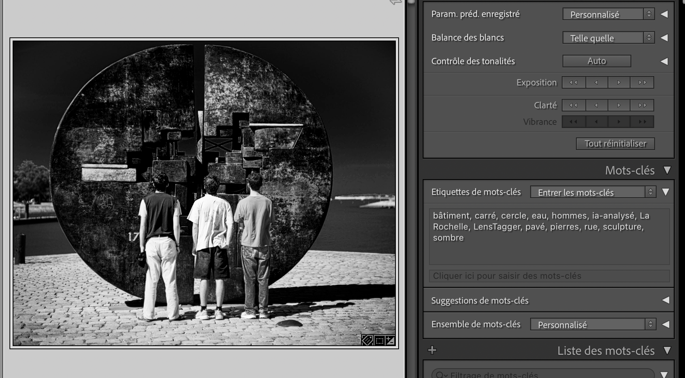
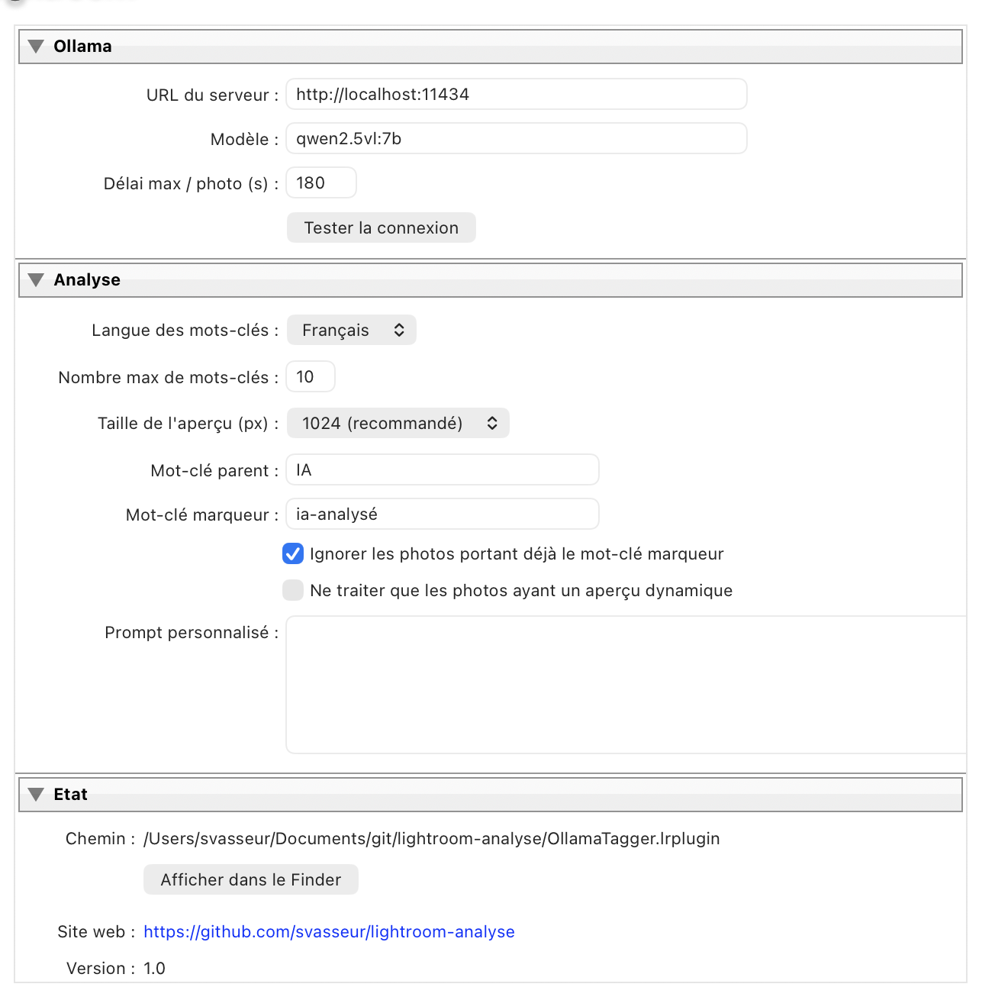

# Ollama Tagger for Lightroom Classic

**Mots-clés automatiques par IA, 100 % en local.**

Ollama Tagger est un module externe (plug-in) pour **Adobe Lightroom Classic**. Il analyse vos photos avec un modèle de vision qui tourne sur votre machine via [Ollama](https://ollama.com), par exemple `qwen2.5vl:7b`, puis ajoute automatiquement des mots-clés décrivant ce qu'il voit : sujet, objets, lieu, ambiance, couleurs…

- 🔒 **Confidentialité** : aucune photo ne quitte votre ordinateur. Pas de cloud, pas de clé d'API, pas d'abonnement.
- ⚡ **Aperçus dynamiques** : fonctionne même quand les originaux sont hors ligne (disque externe débranché). L'analyse se fait alors à partir des aperçus dynamiques (smart previews).
- 🌍 **Français ou anglais** pour les mots-clés.
- 🗂️ **Mots-clés rangés** sous un mot-clé parent (`IA` par défaut), faciles à filtrer, renommer ou supprimer.
- 🛡️ **Non destructif** : le plug-in ajoute des mots-clés mais ne supprime jamais ceux qui existent déjà.
- 🔁 **Reprise** : les photos déjà analysées sont marquées et ignorées au passage suivant.

> 🇬🇧 *Lightroom Classic plug-in that auto-tags your photos using a local vision model served by Ollama (e.g. `qwen2.5vl:7b`). Works with Smart Previews, nothing leaves your machine, existing keywords are never removed. Keywords in French or English. See [English quick start](#english-quick-start).*

---

## Sommaire

- [Exemple](#exemple)
- [Prérequis](#prérequis)
- [Installation](#installation)
- [Utilisation](#utilisation)
- [Réglages](#réglages)
- [Choisir un modèle](#choisir-un-modèle)
- [Fonctionnement](#fonctionnement)
- [Dépannage](#dépannage)
- [Contribuer](#contribuer)
- [English quick start](#english-quick-start)
- [Auteur](#auteur)
- [Licence](#licence)

## Exemple

Photo analysée avec `qwen2.5vl:7b` : le plug-in a ajouté `bâtiment`, `carré`, `cercle`, `eau`, `hommes`, `pavé`, `pierres`, `rue`, `sculpture`, `sombre` et le marqueur `ia-analysé`. Les mots-clés déjà présents sur la photo (`La Rochelle`, `LensTagger`) sont **conservés**.

<p align="center">
  
</p>

Dans la liste des mots-clés, les mots-clés générés sont rangés sous le parent `IA` :

```
IA
 ├─ bâtiment
 ├─ cercle
 ├─ sculpture
 └─ …
ia-analysé
```

> ℹ️ **Le plug-in ne supprime jamais de mots-clés.** Il ne fait qu'en ajouter : vos mots-clés existants restent intacts, même si vous relancez l'analyse sur une photo.

## Prérequis

| Logiciel | Version |
|---|---|
| Adobe Lightroom Classic | 6 ou plus récent (macOS ou Windows) |
| [Ollama](https://ollama.com/download) | 0.5 ou plus récent (requis pour les réponses structurées en JSON) |
| Un modèle de vision | `qwen2.5vl:7b` recommandé (~6 Go), ou `qwen2.5vl:3b` (~3,2 Go) pour les machines modestes |

Prévoyez **16 Go de RAM** pour `qwen2.5vl:7b`, ou 8 Go pour `qwen2.5vl:3b`. Un GPU ou une puce Apple Silicon accélère beaucoup l'analyse.

## Installation

### 1. Installer Ollama et le modèle

Téléchargez Ollama depuis [ollama.com/download](https://ollama.com/download), lancez-le, puis dans un terminal :

```sh
ollama pull qwen2.5vl:7b
```

Vérifiez que le serveur répond :

```sh
curl http://localhost:11434/api/tags
```

### 2. Installer le plug-in

1. Téléchargez la dernière version depuis la page **[Releases](../../releases)**, ou clonez le dépôt :
   ```sh
   git clone https://github.com/svasseur/lightroom-analyse.git
   ```
2. Placez le dossier `OllamaTagger.lrplugin` où vous voulez, de façon permanente. Par exemple :
   - macOS : `~/Library/Application Support/Adobe/Lightroom/Modules/`
   - Windows : `%APPDATA%\Adobe\Lightroom\Modules\`
3. Dans Lightroom Classic : **Fichier › Gestionnaire de modules externes… › Ajouter**, puis sélectionnez le dossier `OllamaTagger.lrplugin`.
4. Dans le même écran, cliquez sur **Tester la connexion**. Le message « Connexion OK » doit s'afficher.

## Utilisation

1. Dans le module **Bibliothèque**, sélectionnez une ou plusieurs photos.
2. Menu **Bibliothèque › Modules externes › Analyser la sélection avec Ollama…**. Le même menu existe aussi dans **Fichier › Modules externes**.
3. Une barre de progression s'affiche en haut à gauche. Vous pouvez **annuler** à tout moment : les photos déjà traitées gardent leurs mots-clés.
4. Un récapitulatif s'affiche à la fin : photos taguées, ignorées et en erreur.

**Astuce : utiliser les aperçus dynamiques.** Créez les aperçus dynamiques (**Bibliothèque › Aperçus › Créer des aperçus dynamiques**). Vous pourrez ensuite analyser tout votre catalogue sans brancher le disque des originaux.

**Astuce : retrouver les photos non analysées.** Filtrez sur l'absence du mot-clé `ia-analysé`.

## Réglages

Les réglages se trouvent dans **Fichier › Gestionnaire de modules externes › Ollama Tagger**.

<p align="center">
  
</p>

| Réglage | Défaut | Description |
|---|---|---|
| URL du serveur | `http://localhost:11434` | Adresse d'Ollama. Peut pointer vers une autre machine du réseau. |
| Modèle | `qwen2.5vl:7b` | N'importe quel modèle de vision installé dans Ollama. |
| Délai max / photo | `180` s | Temps maximum d'attente de la réponse du modèle. |
| Langue des mots-clés | Français | Français ou English. |
| Nombre max de mots-clés | `10` | Entre 1 et 50. |
| Taille de l'aperçu | `1024` px | Taille du côté long de l'image envoyée. Plus grand = plus précis mais plus lent. |
| Mot-clé parent | `IA` | Mot-clé sous lequel les mots-clés générés sont rangés. Vide = à la racine. |
| Mot-clé marqueur | `ia-analysé` | Ajouté à chaque photo analysée, et non inclus à l'export. Vide = désactivé. |
| Ignorer les photos déjà analysées | ✅ | Saute les photos qui portent déjà le marqueur. |
| Aperçu dynamique uniquement | ❌ | Ne traite que les photos qui ont un aperçu dynamique. |
| Prompt personnalisé | *(vide)* | Remplace le prompt par défaut. `%d` est remplacé par le nombre max de mots-clés. Le modèle doit répondre au format `{"tags": ["…"]}`. |

### Exemple de prompt personnalisé

```
Liste au maximum %d mots-clés en français pour une photothèque de voyage :
pays ou type de paysage, monuments, activités, météo, moment de la journée.
Réponds uniquement en JSON : {"tags": ["..."]}
```

## Choisir un modèle

Tout modèle Ollama capable de traiter des images (capacité *vision*) fonctionne. Quelques pistes :

| Modèle | Taille | Remarques |
|---|---|---|
| `qwen2.5vl:7b` | ~6 Go | **Par défaut.** Précis, bons mots-clés en français. |
| `qwen2.5vl:3b` | ~3 Go | Plus rapide et plus léger, mais moins précis en français. |
| `gemma3:4b` | ~3 Go | Bonne alternative multilingue. |
| `llava:7b` | ~4,5 Go | Classique, plutôt à utiliser en anglais. |
| `minicpm-v` | ~5 Go | Bon sur les détails. |

```sh
ollama pull qwen2.5vl:3b
```

Indiquez ensuite le nom exact du modèle dans les réglages du plug-in.

## Fonctionnement

```
Lightroom ──► aperçu JPEG (1024 px) ──► base64 ──► Ollama /api/chat ──► {"tags": [...]} ──► mots-clés
```

1. Le plug-in demande à Lightroom un JPEG de la photo avec `photo:requestJpegThumbnail()`. Lightroom utilise le meilleur aperçu disponible : l'original s'il est accessible, sinon **l'aperçu dynamique**.
2. L'image est encodée en base64 et envoyée à l'API `POST /api/chat` d'Ollama. Un schéma JSON impose la forme de la réponse.
3. Les tags sont nettoyés : mis en minuscules, dédoublonnés, débarrassés des caractères `, ; |`, et limités en nombre.
4. Ils sont créés ou réutilisés sous le mot-clé parent, puis **ajoutés** à la photo. Les mots-clés existants ne sont jamais retirés. Chaque photo est enregistrée dans le catalogue dès qu'elle est traitée.

### Structure du dépôt

```
OllamaTagger.lrplugin/
├── Info.lua                    # Déclaration du plug-in et des menus
├── AnalyzeMenuItem.lua         # Boucle d'analyse, progression, écriture des mots-clés
├── OllamaClient.lua            # Prompt, appel HTTP à Ollama, analyse de la réponse
├── PluginInfoProvider.lua      # Panneau de réglages
├── Defaults.lua                # Valeurs par défaut des préférences
├── Init.lua                    # Initialisation des préférences
└── JSON.lua                    # Encodeur/décodeur JSON en Lua pur
```

## Dépannage

| Problème | Solution |
|---|---|
| « Ollama ne répond pas » | Lancez l'application Ollama ou `ollama serve`. Vérifiez l'URL dans les réglages. |
| « Le modèle … n'est pas installé » | Lancez `ollama pull <modèle>` et vérifiez l'orthographe exacte avec `ollama list`. |
| « aperçu indisponible » | L'original est hors ligne et il n'existe pas d'aperçu dynamique. Reconnectez le disque ou créez les aperçus dynamiques. |
| Très lent sur la première photo | C'est normal : le modèle se charge en mémoire. Les photos suivantes sont beaucoup plus rapides. |
| Délai dépassé | Augmentez le délai max, réduisez la taille de l'aperçu ou choisissez un modèle plus léger. |
| Mots-clés peu pertinents ou mal traduits | Essayez un modèle plus gros (`qwen2.5vl:32b` si votre machine le permet), passez en anglais ou adaptez le prompt. |
| Ollama sur une autre machine | Sur cette machine, lancez Ollama avec `OLLAMA_HOST=0.0.0.0` et mettez son adresse IP dans les réglages. |

Le journal détaillé se trouve dans :
- macOS : `~/Documents/LrClassicLogs/OllamaTagger.log`
- Windows : `Documents\LrClassicLogs\OllamaTagger.log`

**Annuler un étiquetage** : dans la liste des mots-clés, supprimez le mot-clé parent `IA`, ce qui supprime aussi tous ses enfants, ainsi que `ia-analysé`.

## Contribuer

Les contributions sont les bienvenues : rapports de bugs, idées, traductions, prompts améliorés…

1. Forkez le dépôt et créez une branche (`git checkout -b ma-fonctionnalite`).
2. Pendant le développement, renommez le dossier en `OllamaTagger.lrdevplugin` si vous le souhaitez. Après chaque modification, utilisez **Recharger le module externe** dans le gestionnaire.
3. Ouvrez une Pull Request en décrivant le changement.

Pour signaler un bug, joignez si possible votre version de Lightroom, celle d'Ollama, le modèle utilisé et l'extrait du journal correspondant.

### Idées pour la suite

- Génération d'une légende ou d'un titre (champs IPTC)
- Utilisation d'une hiérarchie de mots-clés existante
- Traitement de plusieurs photos en parallèle
- Autres langues

## English quick start

1. Install [Ollama](https://ollama.com/download) and pull a vision model: `ollama pull qwen2.5vl:7b`.
2. Download this repository and put `OllamaTagger.lrplugin` in a permanent location.
3. In Lightroom Classic: **File › Plug-in Manager… › Add**, pick `OllamaTagger.lrplugin`. Set *Langue des mots-clés* to **English** and click *Tester la connexion* (Test connection).
4. In the Library module, select photos, then **Library › Plug-in Extras › Analyser la sélection avec Ollama…**

Keywords are added under an `IA` parent keyword. Existing keywords are never removed. Analyzed photos get an `ia-analysé` marker keyword so they are skipped on the next run. Everything runs locally, and Smart Previews are used when originals are offline.

*The user interface is currently in French. English translation PRs are welcome!*

## Auteur

Développé par **Sébastien Vasseur**, photographe. Retrouvez mes photos sur Instagram : [@svasseur](https://www.instagram.com/svasseur).

## Licence

Distribué sous licence MIT. Voir [LICENSE](LICENSE).

Ce projet n'est ni affilié à Adobe ni soutenu par Adobe. Lightroom est une marque d'Adobe Inc.
